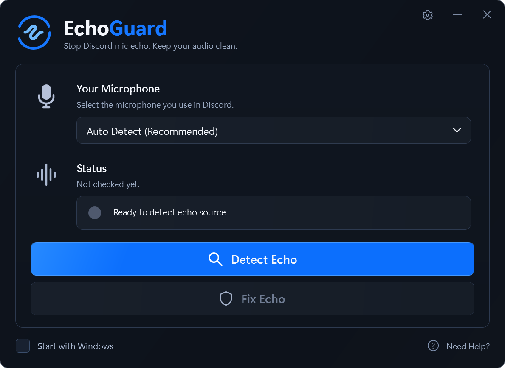

# EchoGuard

Stop duplicated microphone audio during Discord **Entire Screen** sharing while keeping normal voice chat and game/music audio.

[Download Windows installer](https://github.com/wopln/EchoGuard/releases/latest/download/EchoGuardSetup.exe) · [Portable ZIP](https://github.com/wopln/EchoGuard/releases/download/v1.0.0/EchoGuard-1.0.0-win-x64.zip) · [Release notes](https://github.com/wopln/EchoGuard/releases/tag/v1.0.0)



**Version 1.0.0 · Windows 11 x64 · Free and open source · MIT license**

EchoGuard supports one known **SteelSeries Sonar + official Discord desktop** microphone duplication path. It diagnoses the selected input and applies a narrowly targeted, reversible audio-session exclusion only when the supported route is positively identified. It does not fix every kind of echo or every virtual mixer.

## Features

- Automatic microphone suggestions and manual selection, with clear confidence and mismatch explanations.
- Stable device identity preferences and cautious handling of disconnected or recreated endpoints.
- Native event-driven protection that responds to supported audio-session changes without continuous polling.
- Dark WPF interface, native window dragging/resizing/Snap, system tray and optional login startup.
- Diagnostics, local report export, owned-change restoration and complete exit.
- Offline operation: no recording, audio transmission, telemetry, Discord patches or injected code.

## Install

Requires Windows 11 x64 and .NET Framework 4.8 or later, normally included with Windows 11. No administrator rights, additional drivers, packages or services are required.

**Installer:** download `EchoGuardSetup.exe` from [Releases](https://github.com/wopln/EchoGuard/releases/latest), install for your Windows account, and open EchoGuard from Start.

**Portable:** extract the portable ZIP and open `EchoGuard.exe`, keeping `EchoGuard.exe.config` alongside it. Keep the folder in a stable location if you enable Start with Windows.

New profiles start with protection and login startup disabled. Existing preferences are preserved. Windows builds are currently unsigned; SHA-256 checksums are supplied with each release.

## Use

1. Open SteelSeries GG / Sonar and official stable Discord. Select **SteelSeries Sonar - Microphone** as Discord's voice input yourself.
2. Join a voice channel and start **Entire Screen sharing with audio**.
3. In EchoGuard, choose **Auto Detect** or the microphone you actually use in Discord.
4. Click **Detect Echo**. A suggestion alone cannot authorize a fix.
5. Click **Fix Echo** only when the supported route is confirmed. Protection Active means Windows confirmed the targeted session mute; it is not an audible listening test.
6. Listen from another device using headphones: voice should be heard once, game/music should remain audible, and muting normal Discord voice should leave no microphone in the stream. Avoid playing the stream on the sharing PC.

Choosing a microphone does not change Windows defaults or Discord settings. It restores owned changes and disables protection until you explicitly enable it again. The gear opens confidence, device identities, Remember, diagnostics, report export and restoration controls. Close hides to tray; Minimize uses the taskbar.

## How the fix works

The supported duplication comes from an additional Discord session on Sonar's internal microphone **playback/render** endpoint. EchoGuard changes only that positively identified session through Windows Core Audio `ISimpleAudioVolume`, checks the result, and journals ownership for restoration. Normal microphone capture and game/music playback are left untouched.

It does not alter another application's existing capture stream through process-loopback exclusion APIs. See [architecture and safety](docs/ARCHITECTURE.md) and [smart detection](docs/SMART_DETECTION.md).

Sonar metadata and Discord session topology are vendor-specific compatibility assumptions. No public session flag proves that a session contains only screen-sharing microphone audio. Unsupported or ambiguous configurations fail closed. External changes suspend protection for the affected session rather than being continuously overridden.

## Compatibility and current limits

The known Sonar/Discord route was previously tested from a second listening device, including microphone muted/unmuted, music preservation, repeated sharing and Discord restart. Version 1.0.0 retains that mechanism and passes current automated tests. Fresh independent listening, Sonar restart, physical USB/endpoint recreation, reboot/login, mixed-DPI movement and broader hardware/client versions remain pending.

Browser Discord, PTB/Canary/repacked clients, arbitrary virtual mixers and acoustic speaker feedback are not supported echo-fix configurations. Enumerating a microphone does not mean its echo is fixable. Offline publisher verification may fail when required trust data is unavailable. Read [supported configurations](SUPPORTED_CONFIGURATIONS.md), [test results](docs/TESTING.md), and [troubleshooting](docs/TROUBLESHOOTING.md).

Do not run another audio protection helper at the same time. The legacy `AudioInitialization` helper is detected and blocks exclusions to prevent overlapping ownership.

## Disable or uninstall

Use **Disable Protection**, **Settings → Restore previous state**, or **Exit completely** to restore only EchoGuard-owned changes. Pre-existing mutes and observed external overrides are preserved. Recovery records remain if restoration needs attention.

- Installed: use Windows Apps uninstall or the installed Uninstall action. It restores first and refuses unresolved recovery journals.
- Portable: disable Start with Windows, restore and exit, then remove the portable folder.
- Settings and bounded logs are under `%LOCALAPPDATA%\EchoGuard`. Keep `changes.json` while restoration is unresolved. Unrelated reports/files are preserved by uninstall.

See [privacy](PRIVACY.md) and [security](SECURITY.md).

## Build and test

No third-party runtime libraries or package downloads are required. Build scripts use the Windows .NET Framework compiler/WPF assemblies. Visual Studio project builds require the .NET Framework 4.8 developer pack.

```powershell
powershell -NoProfile -ExecutionPolicy Bypass -File .\scripts\build.ps1
powershell -NoProfile -ExecutionPolicy Bypass -File .\scripts\test.ps1
powershell -NoProfile -ExecutionPolicy Bypass -File .\scripts\package.ps1
```

For the interactive WPF/window harness, run `scripts/test-ui.ps1` on an unlocked desktop. It uses a temporary profile with protection disabled. The historical native/live harnesses have additional setup requirements; read their documentation before running them. CI builds the package and runs the 94 pure regression checks.

Current local results: **94 regression checks and 61 WPF/native-window checks passed**. Simulations and native-state checks do not replace real listening or hardware tests.

## License

[MIT](LICENSE). Windows/.NET components are referenced from the installed runtime, not redistributed. See [dependency notices](THIRD_PARTY_NOTICES.md). EchoGuard is not affiliated with or endorsed by Discord, SteelSeries or Microsoft.
